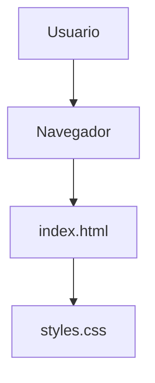

# Lab 01 - Control de Versiones con Git


Proyecto academico desarrollado en el Laboratorio 01 del curso de Diseno de Interfaces de Programacion Avanzado.
Permite practicar el control de versiones con Git y la publicacion de una pagina web utilizando HTML y CSS.

## Tabla de contenidos

- [Instalacion](#instalacion)
- [Uso](#uso)
- [Tecnologias](#tecnologias)
- [Estado del proyecto](#estado-del-proyecto)
- [Hoja de ruta](#hoja-de-ruta)
- [Arquitectura](#arquitectura)
- [Contribucion](#contribucion)
- [Autor](#autor)

## Instalacion

Clonar el repositorio:

```bash
git clone https://github.com/yesicamancilla-stack/lab01-git.git
cd lab01-git
```

## Uso

1. Abrir la carpeta del proyecto.
2. Ejecutar el archivo `index.html` en un navegador.
3. Revisar el contenido y los estilos de la pagina web.

Ejemplo de estructura HTML:

```html
<h1>Lab 01 - Git</h1>
<p>Proyecto de control de versiones</p>
```

## Tecnologias

| Tecnologia | Funcion | Estado |
|:-----------|:-------:|-------:|
| HTML5 | Estructura web | Implementado |
| CSS3 | Estilos visuales | Implementado |
| Git | Control de versiones | Implementado |
| GitHub | Repositorio remoto | Implementado |

## Estado del proyecto

Proyecto academico completado, con archivos HTML y CSS publicados en GitHub.

## Hoja de ruta

- [x] Crear repositorio Git
- [x] Crear pagina HTML
- [x] Agregar estilos CSS
- [x] Realizar commits
- [x] Publicar en GitHub
- [ ] Ampliar funcionalidades

## Arquitectura



## Contribucion

Consulta la [guia de contribucion](CONTRIBUTING.md) antes de proponer cambios.

## Autor

**Yesica Mancilla**

[Perfil de GitHub](https://github.com/yesicamancilla-stack)
